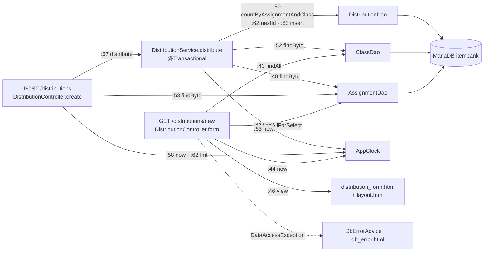

# legacy/assignment-thymeleaf 아키텍처 — "새 배포" 화면

> 분석 범위: **과제 배포 화면 하나(`distribution_form.html`, 메뉴 "새 배포")와 그 화면이 부르는 코드까지만.**
> - 포함: `GET /distributions/new`(폼 표시), `POST /distributions`(폼 제출 · 배포 등록)과 여기서 호출하는 Service · DAO · 템플릿 · 설정.
> - 제외: 배포 목록(`GET /distributions`), 재배포(`POST /distributions/{id}/redistribute`, `DistributionService.java:70-701`), 과제 목록(`AssignmentController`). POST 성공 시 `/distributions` 로 리다이렉트하는 것까지만 적는다.

## 1. 모듈 개요

- Spring MVC + Thymeleaf 화면 모듈이다. DB 접근은 `JdbcTemplate` 으로 SQL 문자열을 직접 실행한다 (`AssignmentDao.java:15`, `ClassDao.java:14`, `DistributionDao.java:17`).
- 컨테이너 안에서는 8080 으로 뜨고 (`application.properties:1`), compose `thymeleaf` 프로필이 호스트 8082 로 연다 (`docker-compose.yml:53-54`).
- DB 는 MariaDB `itembank` 를 문항 은행과 함께 쓴다 (`application.properties:2`, `db/mariadb/init/01-schema.sql:72-73`).
- 커넥션 풀 최대 4, 획득 대기 5초 (`application.properties:6-7`).
- 현재 시각은 `AppClock.now()` 로 구하며, 시스템 속성 `app.clock=system` 이 아니면 `2026-09-15 00:00:00` 고정값을 돌려준다 (`AppClock.java:9`, `AppClock.java:14-20`).

## 2. 진입점

| 경로 | 메서드 | 파일:줄번호 | 역할 |
|---|---|---|---|
| `/distributions/new` | GET | `DistributionController.java:40-47` | 과제 선택 목록 · 학급 목록을 모델에 담아 `distribution_form` 뷰를 그린다 |
| `/distributions` | POST | `DistributionController.java:49-77` | 폼 값 `assignmentId` · `classId` 로 배포를 등록한다. 성공 시 `redirect:/distributions`, 실패 시 오류 flash 와 함께 `redirect:/distributions/new` |
| (예외 처리) `DataAccessException` | — | `DbErrorAdvice.java:11-17` | 컨트롤러 밖으로 나온 DB 예외를 `db_error` 뷰로 바꾼다. GET 폼 조회 실패가 여기로 온다 |

- 화면 진입 링크: 상단 메뉴 "새 배포" (`layout.html:26`).
- 폼은 `POST /distributions` 로 전송한다 (`distribution_form.html:8`).
- 두 요청 파라미터는 `@RequestParam ... long` 이고 `required` 기본값이다 (`DistributionController.java:50-51`). 빈 값 · 숫자 아님일 때의 응답은 이 모듈 코드에 처리가 없다 → **확인 필요**(Spring 기본 동작).

## 3. 의존 관계

화살표는 "A → B (A 의 해당 줄이 B 를 호출)" 을 뜻한다.

### 호출 순서

**GET `/distributions/new`**
1. `assignmentDao.findAllForSelect()` → `model.assignments` (`DistributionController.java:42`, `AssignmentDao.java:34-39`)
2. `classDao.findAll()` → `model.classes` (`DistributionController.java:43`, `ClassDao.java:20-22`)
3. `AppClock.now()` → `model.now` (`DistributionController.java:44`)
4. `menu = "new"`, 뷰 `distribution_form` (`DistributionController.java:45-46`)
5. 뷰는 `layout :: head` · `nav` · `flash` · `footer` 조각을 끼운다 (`distribution_form.html:3`, `:5`, `:7`, `:32`)

**POST `/distributions`**
1. `assignmentDao.findById(assignmentId)` — 없으면 flash error 후 폼으로 (`DistributionController.java:53-57`)
2. `AppClock.now()` 로 마감 검사, 연장(`X`)이 아니면 flash error 후 폼으로 (`DistributionController.java:58-65`)
3. `distributionService.distribute(assignmentId, classId)` (`DistributionController.java:67`)
   1. `assignmentDao.findById` — 다시 조회 (`DistributionService.java:48`)
   2. `classDao.findById` (`DistributionService.java:52`)
   3. 상태 `D` 검사 (`DistributionService.java:56-58`)
   4. `distributionDao.countByAssignmentAndClass` (`DistributionService.java:59`)
   5. `distributionDao.nextId` → `distributionDao.insert(..., AppClock.now())` (`DistributionService.java:62-63`)
4. 성공 flash `message` 후 `redirect:/distributions` (`DistributionController.java:68`, `:76`)
5. `IllegalArgumentException` · `IllegalStateException` · `DataAccessException` 은 컨트롤러에서 잡아 flash `error` 로 바꾸고 폼으로 돌린다 (`DistributionController.java:69-75`)

### 외부 의존

| 종류 | 대상 | 근거 |
|---|---|---|
| DB 연결 | MariaDB `itembank`, 계정 `app` (환경 변수 우선) | `application.properties:2-5` |
| 커넥션 풀 | Hikari max 4, timeout 5000ms, 기동 시 DB 실패 무시(`-1`) | `application.properties:6-8` |
| 뷰 | `distribution_form.html`, 조각 `layout.html`, 오류 `db_error.html` | `DistributionController.java:46`, `distribution_form.html:3`, `DbErrorAdvice.java:16` |
| 시각 | `AppClock` 정적 메서드 (빈 아님) | `AppClock.java:14`, `AppClock.java:22` |
| 로그 | `System.out.println` (DB 오류 시) | `DbErrorAdvice.java:13` |
| 다른 모듈 | 없음. 단 `unit` 테이블은 문항 은행 모듈 소유를 조인만 한다 | `AssignmentDao.java:24` |

## 4. 구조상 특이점

- 컨트롤러가 Service 를 거치지 않고 DAO 를 직접 주입받아 쓴다 (`DistributionController.java:23-24`, `:42-43`, `:53`).
- 과제 조회 · 마감 검사가 컨트롤러(`:53-65`)에 있고, 존재 검사는 Service(`DistributionService.java:48-51`)에 한 번 더 있다. 마감 검사는 Service 에 없다.
- 마감 검사는 트랜잭션 밖(컨트롤러)에서, 중복 검사 · INSERT 는 `@Transactional` 안(`DistributionService.java:46`)에서 한다.
- 컨트롤러가 예외를 직접 잡아 화면 메시지로 바꾼다 (`DistributionController.java:66-75`). GET 쪽 DB 예외만 `DbErrorAdvice` 로 간다.
