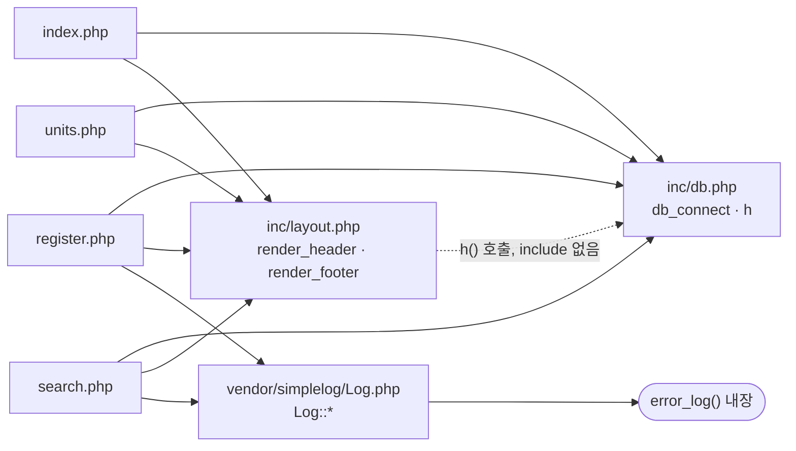

# legacy/item-bank-php 아키텍처

> 분석 범위: 진입점 · 의존 관계까지. 데이터 흐름 · 비즈니스 규칙은 아직 분석하지 않았다.
> `search.php:46-541`(`buildSearchQuery` 본문)은 함수 호출 줄만 grep 으로 확인했다.

## 1. 모듈 개요

- 문항 은행 화면 모듈이다. PHP 7.4 + Apache, DB 접근은 `mysqli` 를 쓴다 (`Dockerfile:1-3`).
- 라우터 · 프레임워크가 없고, 최상위 `.php` 파일 하나가 URL 하나다.
- 화면은 홈 · 문항 검색 · 문항 등록 · 단원 목록 4개다 (`index.php:9-11`).
- compose `php` 프로필로 뜨고, 호스트 8081 → 컨테이너 80 이다 (`docker-compose.yml:37-39`).
- DB 접속 정보는 환경 변수에서 읽고, 없으면 compose 기본값을 쓴다 (`inc/db.php:14-18`).

## 2. 폴더 구조

```
legacy/item-bank-php/
├── Dockerfile              16줄   php:7.4-apache, mysqli, rewrite
├── index.php               14줄   홈 (메뉴)
├── search.php             731줄   문항 검색 — 함수 4개
├── register.php           177줄   문항 등록 — 1~140 로직, 141~177 폼 HTML
├── units.php               48줄   단원 목록
├── inc/
│   ├── db.php              37줄   db_connect, h
│   └── layout.php          43줄   render_header, render_footer
└── vendor/
    └── simplelog/Log.php   54줄   외부 라이브러리(더미), error_log 로만 기록
```

## 3. 진입점

| URL / 화면 | 처음 실행되는 파일 | 주요 호출 (순서대로) |
|---|---|---|
| `/index.php` 홈 | `index.php:1` | `render_header('홈')` `index.php:5` → 메뉴 링크 3개 `index.php:9-11` → `render_footer()` `index.php:14` |
| `GET /search.php` 문항 검색 | `search.php:1` | `Log::setThreshold` `search.php:27` → `render_header` `search.php:709` → `db_connect` `search.php:713` → `buildSearchQuery($_GET, $conn)` `search.php:722` → `renderSearchForm` `search.php:723` → `runSearchQuery` `search.php:724` → `renderResultTable` `search.php:725` → `render_footer` `search.php:731` |
| `GET /register.php` 등록 폼 | `register.php:1` | `db_connect` `register.php:17` → 단원 · 태그 목록 조회 `register.php:27`, `register.php:34` → `render_header` `register.php:127` → 폼 출력 `register.php:141` → `render_footer` `register.php:177` |
| `POST /register.php` 문항 등록 | `register.php:1` | 위 흐름 + 입력 검증 `register.php:47-81` → `begin_transaction` `register.php:85` → 다음 id 조회 `register.php:87` → item INSERT `register.php:92-101` → item_tag INSERT `register.php:105-111` → `commit` `register.php:114` → `Log::info` `register.php:115`. 실패 시 `rollback` `register.php:120`, `Log::error` `register.php:121` |
| `/units.php` 단원 목록 | `units.php:1` | `render_header` `units.php:5` → `db_connect` `units.php:8` → 단원별 문항 수 쿼리 `units.php:16-20` → 표 출력 `units.php:33-46` → `render_footer` `units.php:48` |

- 검색 폼은 자기 자신으로 GET 전송한다 (`search.php:632`).
- 등록 폼은 자기 자신으로 POST 전송한다 (`register.php:141`).

## 4. 의존 관계

화살표는 "A → B (A 가 B 를 포함하거나 호출)" 를 뜻한다. 점선은 include 없이 호출만 하는 숨은 의존이다.



### 파일 간 include · 호출

| A → B | 종류 | 근거 |
|---|---|---|
| `index.php` → `inc/db.php`, `inc/layout.php` | include | `index.php:2-3` |
| `units.php` → `inc/db.php`, `inc/layout.php` | include | `units.php:2-3` |
| `register.php` → `inc/db.php`, `inc/layout.php`, `vendor/simplelog/Log.php` | include | `register.php:2-4` |
| `search.php` → `inc/db.php`, `inc/layout.php`, `vendor/simplelog/Log.php` | include | `search.php:20-22` |
| `inc/layout.php` → `inc/db.php` | 호출 `h()` (include 없음) | `inc/layout.php:17`, `inc/layout.php:33` |
| `units.php` → `inc/db.php` | 호출 `db_connect` | `units.php:8` |
| `register.php` → `inc/db.php` | 호출 `db_connect` | `register.php:17` |
| `search.php` → `inc/db.php` | 호출 `db_connect` | `search.php:713` |
| `register.php` → `vendor/simplelog/Log.php` | 호출 `Log::info`, `Log::error` | `register.php:115`, `register.php:121` |
| `search.php` → `vendor/simplelog/Log.php` | 호출 `Log::setThreshold`, `Log::debug`, `Log::error` | `search.php:27`, `search.php:103`, `search.php:528`, `search.php:537`, `search.php:727` |
| `vendor/simplelog/Log.php` → PHP 내장 `error_log()` | 호출 | `vendor/simplelog/Log.php:52` |

`inc/layout.php` 는 `h()` 를 쓰지만 `inc/db.php` 를 include 하지 않는다. 호출하는 쪽이 `inc/db.php` 를 먼저 include 해야 동작한다.

### search.php 내부 호출

| A → B | 근거 |
|---|---|
| 실행부 → `buildSearchQuery` | `search.php:722` |
| 실행부 → `renderSearchForm` | `search.php:723` |
| 실행부 → `runSearchQuery` | `search.php:724` |
| 실행부 → `renderResultTable` | `search.php:725` |
| `buildSearchQuery` → `h()` | `search.php:360-513` (여러 곳) |
| `buildSearchQuery` → DB 직접 조회 (단원 · 단원 목록 · 태그 목록) | `search.php:125`, `search.php:156`, `search.php:178` |
| `runSearchQuery` → DB prepared statement (건수 · 목록) | `search.php:577`, `search.php:600` |
| `renderResultTable` → `h()` | `search.php:674-696` |

## 5. 가장 긴 함수 3개

| 순위 | 파일 | 함수 | 시작 ~ 끝 | 줄 수 | 하는 일 |
|---|---|---|---|---|---|
| 1 | `search.php` | `buildSearchQuery` | `search.php:42` ~ `search.php:564` | 523 | GET 파라미터로 검색 SQL · 건수 SQL · 바인딩 값을 만들고, 폼 · 요약 · 정렬 링크 HTML 도 만든다 (docblock `search.php:30-36`, 반환 배열 `search.php:546-563`). 본문 분기는 미확인 |
| 2 | `search.php` | `renderResultTable` | `search.php:647` ~ `search.php:704` | 58 | 결과 건수 · 결과 표 · 페이지 링크를 출력한다. 0건이면 안내 문구만 출력한다 (`search.php:657-659`) |
| 3 | `search.php` | `runSearchQuery` | `search.php:571` ~ `search.php:624` | 54 | 건수 쿼리와 목록 쿼리를 prepared statement 로 실행해 `total` · `rows` 를 돌려준다 |

그다음은 `render_header`(`inc/layout.php:7-36`, 30줄), `db_connect`(`inc/db.php:7-29`, 23줄) 순이다. `register.php` · `units.php` 는 함수 없이 최상위 스크립트로 되어 있다.

## 6. 미확인 목록

### 읽지 않은 범위

- `search.php:46-541` — `buildSearchQuery` 본문 로직 (호출 줄만 grep 으로 확인)
- `register.php:142-175` — 폼 HTML (PHP 조각만 확인)
- `a2enmod rewrite`(`Dockerfile:4`) 가 실제로 쓰이는지. 모듈 안에 `.htaccess` 는 없다.
- 문항 상태값 전체 목록. 코드에서 본 값은 공개 `'A'`(`units.php:17`) 와 등록 직후 `'R'`(`register.php:94`) 뿐이다.

### 확인 필요 (다음 단계에서 판단)

- **주석과 코드가 다르다**: `buildSearchQuery` docblock(`search.php:33-36`)에 없는 `warning_html` · `form_html` · `page_prefix` 키를 반환한다 (`search.php:547`, `search.php:549`, `search.php:551`). `renderSearchForm` · `renderResultTable` 이 이 키를 쓴다 (`search.php:631`, `search.php:652`, `search.php:690`). 코드를 기준으로 본다.
- **XSS 가능성**: `form_html` · `warning_html` · `summary_html` · `sort_links` 를 이스케이프 없이 출력한다 (`search.php:633-637`, `search.php:652-653`, `search.php:665-669`). 조립할 때 모든 값이 `h()` 를 거쳤는지 확인 필요.
- **id 채번**: `MAX(id)+1 ... FOR UPDATE` 로 새 id 를 직접 계산한다 (`register.php:87`). 동시 등록 시 충돌하는지 확인 필요.
- **로그에 검색어**: `Log::debug` 에 사용자 검색어를 넘긴다 (`search.php:103`). 기준 레벨이 INFO(`search.php:27`) 라 기본 설정에서는 기록되지 않는다.
