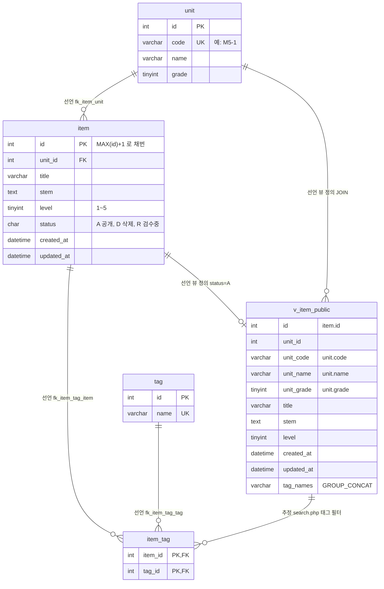

# legacy/item-bank-php 데이터 흐름 · ERD

> 분석 범위: `legacy/item-bank-php` 가 읽고 쓰는 테이블 · 뷰. 진입점 · 의존 관계는 [ARCHITECTURE.md](ARCHITECTURE.md) 를 따른다.
> 근거 파일: `db/mariadb/init/01-schema.sql`(스키마), `legacy/item-bank-php/*.php`(SQL 문).
> 이 문서의 `search.php` · `register.php` · `units.php` 는 모두 `legacy/item-bank-php/` 아래 파일이다.
> 모듈 안에서 SQL 이 있는 파일은 `search.php` · `register.php` · `units.php` 3개다. `index.php` · `inc/` · `vendor/` 에는 SQL 이 없다 (grep 확인).

## 1. 테이블 목록

모듈이 쓰는 DB 객체는 테이블 4개 + 뷰 1개다. 모두 MariaDB `itembank` 에 있다 (`01-schema.sql:5-6`).

| 이름 | 종류 | 주요 컬럼 | 키 · 제약 | 근거 |
|---|---|---|---|---|
| `unit` | 테이블 | `id` INT, `code` VARCHAR(16), `name` VARCHAR(100), `grade` TINYINT | PK `id`, UNIQUE `code` | `01-schema.sql:11-18` |
| `item` | 테이블 | `id` INT, `unit_id` INT, `title` VARCHAR(200), `stem` TEXT, `level` TINYINT, `status` CHAR(1) 기본 `'A'`, `created_at` DATETIME, `updated_at` DATETIME | PK `id`(AUTO_INCREMENT 아님), FK `unit_id` → `unit.id`, INDEX `unit_id` · `level` | `01-schema.sql:20-33` |
| `tag` | 테이블 | `id` INT, `name` VARCHAR(50) | PK `id`, UNIQUE `name` | `01-schema.sql:35-40` |
| `item_tag` | 테이블 (문항-태그 N:M 조인) | `item_id` INT, `tag_id` INT | PK `(item_id, tag_id)`, FK `item_id` → `item.id`, FK `tag_id` → `tag.id` | `01-schema.sql:42-48` |
| `v_item_public` | 뷰 | `id`, `unit_id`, `unit_code`, `unit_name`, `unit_grade`, `title`, `stem`, `level`, `created_at`, `updated_at`, `tag_names`(태그 이름을 `t.id` 순으로 `,` 연결) | `item` JOIN `unit`, `WHERE i.status = 'A'` | `01-schema.sql:52-70` |

- `item.level` 은 스키마 주석상 1~5 다 (`01-schema.sql:25`). DB 제약(CHECK)은 없고, 등록 화면이 `/^[1-5]$/` 로 검증한다 (`register.php:70`).
- `item.status` 값은 스키마 주석상 `A`=공개 · `D`=삭제 · `R`=검수중이다 (`01-schema.sql:26`). 모듈 코드에 나오는 값은 `'A'`(`units.php:17`, 뷰 `01-schema.sql:70`) 와 `'R'`(`register.php:94`) 뿐이다. `'D'` 는 시드에만 있다 (`02-seed.sql:49`, `02-seed.sql:63`).
- 같은 스키마 파일의 `class` · `assignment` · `distribution` · `submission`(`01-schema.sql:75-115`)은 이 모듈이 참조하지 않는다 (grep 확인). 그중 `assignment.unit_id` 가 `unit.id` 를 FK 로 참조한다 (`01-schema.sql:89`). 다른 모듈의 테이블이라 아래 ERD 에서는 뺐다.

## 2. 테이블 관계

- **선언**: 스키마 DDL 에 선언된 관계. FK 제약이거나 뷰 정의(`CREATE VIEW`)다.
- **추정**: FK 없이 코드의 JOIN · 상관 서브쿼리 조건에서 추정한 관계.



| 관계 | 구분 | 조건 | 근거 (선언) | 코드에서 쓰는 곳 |
|---|---|---|---|---|
| `unit` 1 : N `item` | 선언 (FK) | `item.unit_id = unit.id` | `01-schema.sql:32` | 뷰 JOIN `01-schema.sql:69`, 상관 서브쿼리 `units.php:17` |
| `item` 1 : N `item_tag` | 선언 (FK) | `item_tag.item_id = item.id` | `01-schema.sql:46` | 뷰 서브쿼리 `01-schema.sql:65-67`, INSERT `register.php:105` |
| `tag` 1 : N `item_tag` | 선언 (FK) | `item_tag.tag_id = tag.id` | `01-schema.sql:47` | 뷰 JOIN `01-schema.sql:66`, 태그 필터 JOIN `search.php:244` |
| `item` → `v_item_public` | 선언 (뷰 정의, FK 아님) | `status = 'A'` 인 `item` 한 행이 뷰 한 행 | `01-schema.sql:52-70` | 검색 FROM `search.php:522` |
| `unit` → `v_item_public` | 선언 (뷰 정의, FK 아님) | `u.id = i.unit_id` 로 `unit_code` · `unit_name` · `unit_grade` 를 붙임 | `01-schema.sql:56-58`, `01-schema.sql:69` | 단원 필터 `search.php:118` |
| `v_item_public` 1 : N `item_tag` | 추정 | `it.item_id = v_item_public.id` (EXISTS 상관 서브쿼리) | 없음 (뷰에는 FK 를 걸 수 없다) | `search.php:244-245` |

- 태그 필터는 `v_item_public.tag_names` 문자열이 아니라 `item_tag` · `tag` 를 다시 조인해서 건다 (`search.php:244-245`). 표시용은 `tag_names`(`search.php:521`, `search.php:678`)다.
- 단원 필터는 `unit_code = ?` 로 뷰 컬럼과 비교하고 (`search.php:118`), 단원 이름은 `unit` 을 `code` 로 따로 조회해 요약에만 쓴다 (`search.php:125`, `search.php:133`). JOIN 이 아니라서 관계로 그리지 않았다.

## 3. 읽기 · 쓰기 위치

`register.php` · `units.php` 에는 함수가 없다 (ARCHITECTURE.md §5). 그래서 이 두 파일은 "최상위 스크립트"로 적는다.
`search.php` 는 SQL 을 `buildSearchQuery` 가 조립하고 `runSearchQuery` 가 실행한다. 둘을 구분해 적는다.

### `unit`

| 동작 | 파일 · 함수 | SQL 요지 | 근거 |
|---|---|---|---|
| SELECT | `register.php` 최상위 스크립트 | 단원 선택 목록 `SELECT id, code, name FROM unit ORDER BY grade, code` | `register.php:27` |
| SELECT | `search.php` `buildSearchQuery` | 요약용 단원 이름 `SELECT name, grade FROM unit WHERE code = ?` | `search.php:125` |
| SELECT | `search.php` `buildSearchQuery` | 단원 선택 목록 `SELECT code, name, grade FROM unit ORDER BY grade, code` | `search.php:156` |
| SELECT | `units.php` 최상위 스크립트 | 단원 목록 + 공개 문항 수 | `units.php:16-19` |
| SELECT (간접) | `search.php` `runSearchQuery` | `v_item_public` 을 거쳐 읽음 | `search.php:577`, `search.php:600` |
| INSERT · UPDATE · DELETE | 없음 | — | 모듈 grep 결과 없음 |

### `item`

| 동작 | 파일 · 함수 | SQL 요지 | 근거 |
|---|---|---|---|
| SELECT (잠금) | `register.php` 최상위 스크립트 | 다음 id `SELECT COALESCE(MAX(id), 0) + 1 ... FROM item FOR UPDATE` (트랜잭션 안) | `register.php:85-87` |
| SELECT | `units.php` 최상위 스크립트 | `SELECT COUNT(*) FROM item i WHERE i.unit_id = u.id AND i.status = 'A'` (상관 서브쿼리) | `units.php:17` |
| SELECT (간접) | `search.php` `runSearchQuery` | `v_item_public` 을 거쳐 읽음 | `search.php:577`, `search.php:600` |
| **INSERT** | `register.php` 최상위 스크립트 (POST) | `status='R'`, `created_at` · `updated_at` = `NOW()` | `register.php:92-101` |
| UPDATE · DELETE | 없음 | — | 모듈 grep 결과 없음 |

### `tag`

| 동작 | 파일 · 함수 | SQL 요지 | 근거 |
|---|---|---|---|
| SELECT | `register.php` 최상위 스크립트 | 태그 선택 목록 `SELECT id, name FROM tag ORDER BY id` | `register.php:34` |
| SELECT | `search.php` `buildSearchQuery` | 태그 선택 목록 `SELECT name FROM tag ORDER BY id` | `search.php:178` |
| SELECT | `search.php` `buildSearchQuery`(조립) → `runSearchQuery`(실행) | 태그 필터 `EXISTS (... JOIN tag t ... AND t.name = ?)` | 조립 `search.php:244-245`, 실행 `search.php:577`, `search.php:600` |
| SELECT (간접) | `search.php` `runSearchQuery` | 뷰의 `tag_names` 서브쿼리 | `01-schema.sql:64-67` |
| INSERT · UPDATE · DELETE | 없음 | — | 모듈 grep 결과 없음 |

### `item_tag`

| 동작 | 파일 · 함수 | SQL 요지 | 근거 |
|---|---|---|---|
| SELECT | `search.php` `buildSearchQuery`(조립) → `runSearchQuery`(실행) | 태그 필터 `EXISTS (SELECT 1 FROM item_tag it ...)` | 조립 `search.php:244-245`, 실행 `search.php:577`, `search.php:600` |
| SELECT (간접) | `search.php` `runSearchQuery` | 뷰의 `tag_names` 서브쿼리 | `01-schema.sql:64-67` |
| **INSERT** | `register.php` 최상위 스크립트 (POST) | 검증 통과한 태그마다 `INSERT INTO item_tag (item_id, tag_id)` — `item` INSERT 와 같은 트랜잭션 | `register.php:104-113` |
| UPDATE · DELETE | 없음 | — | 모듈 grep 결과 없음 |

### `v_item_public` (뷰)

| 동작 | 파일 · 함수 | SQL 요지 | 근거 |
|---|---|---|---|
| SELECT | `search.php` `buildSearchQuery`(조립) | `SELECT id, title, unit_code, level, tag_names, created_at FROM v_item_public` + WHERE + ORDER BY + `LIMIT 20 OFFSET ?`, 건수 SQL 은 `SELECT COUNT(*)` | `search.php:521-526` |
| SELECT | `search.php` `runSearchQuery`(실행) | 건수 → 목록 순서로 prepared statement 실행 | `search.php:577`, `search.php:600` |

### 흐름 요약

```
[GET  /search.php]   unit · tag (선택 목록) ─┐
                     v_item_public ⟵ item + unit (+ item_tag · tag) ── 검색 결과 (status='A' 만)
[GET  /units.php]    unit + item(status='A' COUNT)
[GET  /register.php] unit · tag (선택 목록)
[POST /register.php] item (MAX+1 FOR UPDATE) → INSERT item(status='R') → INSERT item_tag → COMMIT
```

등록한 문항은 `status='R'` 이라 뷰 조건 `status = 'A'`(`01-schema.sql:70`)에 걸려 검색에 나오지 않는다 (`register.php:84`). `R` → `A` 로 바꾸는 코드는 이 모듈에 없다.

## 4. 미확인 · 확인 필요

### 미확인

- **`item.status` 변경 경로**: `R` → `A`(검수 완료), `A` → `D`(삭제)로 바꾸는 UPDATE 가 이 모듈에 없다. 어느 시스템 · 화면이 바꾸는지 미확인.
- **`item.updated_at` 갱신 주체**: 등록 시 `NOW()` 로 넣는 것만 확인했다 (`register.php:94`). 갱신하는 코드는 미확인.
- **`unit` · `tag` 쓰기 경로**: 모듈에 INSERT · UPDATE · DELETE 가 없다. 시드(`02-seed.sql:9`, `02-seed.sql:19`) 외의 관리 경로는 미확인.
- **`status` 값 전체 목록**: 스키마 주석(`01-schema.sql:26`)의 A · D · R 외 값이 있는지 미확인. DB 에 CHECK 제약이 없다.
- `v_item_public` 의 `unit_id` · `unit_name` · `unit_grade` · `stem` · `updated_at` 컬럼은 모듈 코드가 SELECT 목록에 넣지 않는다 (`search.php:521`). 다만 `stem` 은 WHERE 에서 쓴다 (`search.php:98`). 다른 소비자가 있는지 미확인.

### 확인 필요 (주석과 코드가 다름 — 코드 기준으로 기술함)

- **스키마 주석 vs 등록 화면**: 스키마 주석은 "검색 화면과 등록 화면이 모두 이 뷰를 기준으로 삼는다"고 쓴다 (`01-schema.sql:50-51`). 그러나 `register.php` 는 `v_item_public` 을 참조하지 않고 `unit` · `tag` · `item` 을 직접 읽고 쓴다 (`register.php:27`, `register.php:34`, `register.php:87`).
- **난이도 빈 값**: 주석은 "비어 있으면 전체 난이도 검색 (1~5 모두 포함)"이라고 쓰지만 (`search.php:213`), 코드는 `AND level < 5` 를 붙여 난이도 5 를 뺀다 (`search.php:214-215`). 시드 주석도 "`status='A' AND level<5` 는 정확히 20건"이라고 코드 쪽 동작을 전제한다 (`02-seed.sql:34`). 의도인지 버그인지 확인 필요. 이관 시 characterization 비교 대상이다.
- **공개 조건 중복**: 공개 판정 `status = 'A'` 가 뷰(`01-schema.sql:70`)와 `units.php:17` 두 곳에 따로 있다. `units.php` 는 뷰를 쓰지 않고 `item` 을 직접 센다.
- **id 채번 충돌**: `item.id` 는 AUTO_INCREMENT 가 아니고 `MAX(id)+1 ... FOR UPDATE` 로 계산한다 (`register.php:87`). 동시 등록 시 동작 확인 필요 (ARCHITECTURE.md §6 과 같은 항목).
- **태그 중복 전송**: `$_POST['tags']` 에 같은 id 가 두 번 오면 `$validTagIds` 에도 두 번 들어간다 (`register.php:75-80`). 그러면 `item_tag` PK `(item_id, tag_id)`(`01-schema.sql:45`) 위반으로 INSERT 가 실패하고, 문항 등록 전체가 롤백된다 (`register.php:108-109`, `register.php:119-122`). 실제로 재현되는지 확인 필요.
- **`created_at` 시각 출처**: 등록 시각은 PHP 가 아니라 DB 의 `NOW()` 다 (`register.php:94`). 시드는 고정 시각(`2026-09-01 09:00:00`)이라 새로 등록한 문항만 실제 시각을 갖는다. `sort=created` 정렬(`search.php:309-315`) 결과에 영향이 있다.
